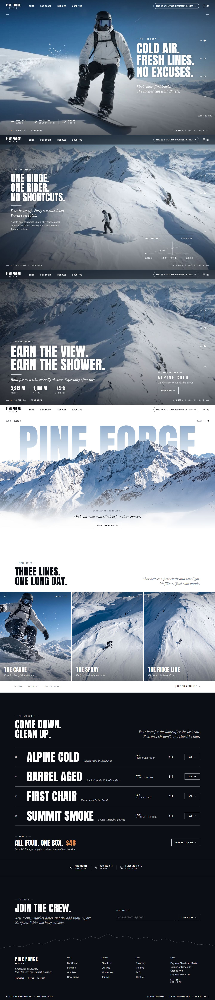

<div align="center">

# Pine Forge Soap Co. — Earn the Shower

**Real scent. Real soap. Built for men who actually shower — especially after a day on the mountain.**

### [View the live site →](https://saidur289.github.io/surfing-landing-page/)

[](https://github.com/Saidur289/surfing-landing-page/actions/workflows/deploy.yml)


</div>

---

## Full page



## Sections

| # | Section | What it does |
|---|---|---|
| 1 | **The Ride** | 240 video frames drawn to a canvas and scrubbed by scroll, so the footage moves as you scroll. Three chapters (*The Drop*, *The Ridge*, *The Summit*) with a viewfinder HUD, frame counter, live altitude, a chapter rail and a self-drawing route profile. |
| 2 | **Rise** | The **PINE FORGE** name rises from behind a mountain cut-out in parallax. The mountain's base blurs and fades into the white page. |
| 3 | **Field Notes** | Three edge-to-edge photos with minimal captions, clip-path reveals, inner parallax and hover focus. |
| 4 | **The Après Kit** | A scent list on ink. Rows draw in line by line, a photo follows the cursor, and *Add* updates the bag count. |
| 5 | **Footer** | Newsletter sign-up with validation, a ridge line that draws itself, link columns, market hours and back-to-top. |

## Built with

- **HTML / CSS / vanilla JS**: no build step, no framework
- **[GSAP 3](https://gsap.com/) + ScrollTrigger** for the scroll-driven timelines
- **[Lenis](https://github.com/darkroomengineering/lenis)** for smooth scrolling
- **Google Fonts**: Anton, Oswald, Playfair Display, Inter

The visual rules (colour tokens, type scale, buttons, section recipes) are documented in [`design_style.md`](design_style.md).

## Responsive

Tested at 320, 390, 768, 1024, 1280 and 1920 px with no horizontal scroll:

- Chapter copy moves clear of the rider on tablets and squarer screens.
- The mountain scales with screen height, and the name is positioned in JS so it always tucks behind the peak.
- On phones, the photos become a swipe row and the scent list shows thumbnails instead of the cursor preview.
- `prefers-reduced-motion` turns off smooth scrolling, the intro animation and the ambient loops.

## Project structure

```
├── index.html
├── styles.css
├── main.js
├── design_style.md          # design system for every section
├── assets/
│   ├── frames/              # 240 JPG frames for the scroll-scrubbed ride
│   └── img/                 # mountain + alpha mask, field-note photos
├── screenshots/
└── .github/workflows/deploy.yml
```

## Run locally

Serve the folder over HTTP. Any static server works, for example:

```bash
npx serve .
```

Then open the printed URL. Opening `index.html` straight from disk also works.

## Deployment

Every push to `main` runs [`deploy.yml`](.github/workflows/deploy.yml), which copies the site files and publishes them to **GitHub Pages**:
**https://saidur289.github.io/surfing-landing-page/**

## Notes

- The newsletter form validates and confirms on the page but isn't connected to an email service yet.
- Navigation and shop links are placeholders (`#`).
- The original PNG frames and full-size photos are kept out of the repo. The site uses the compressed copies in `assets/`.
